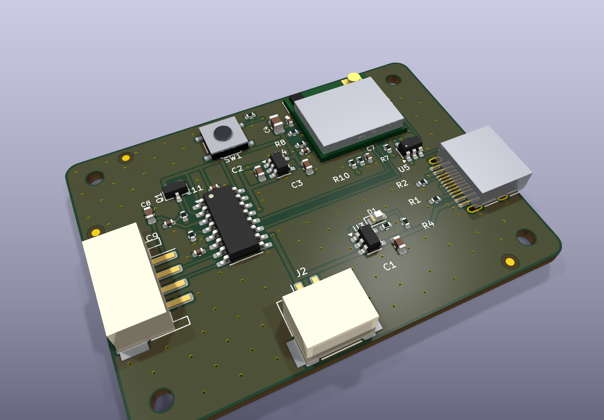
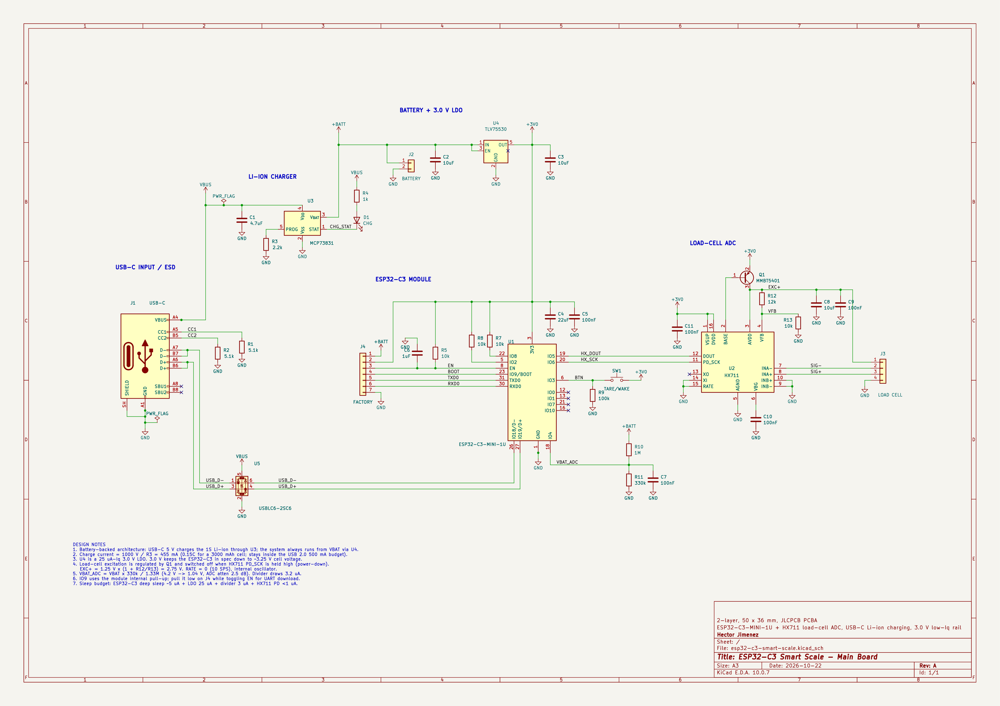
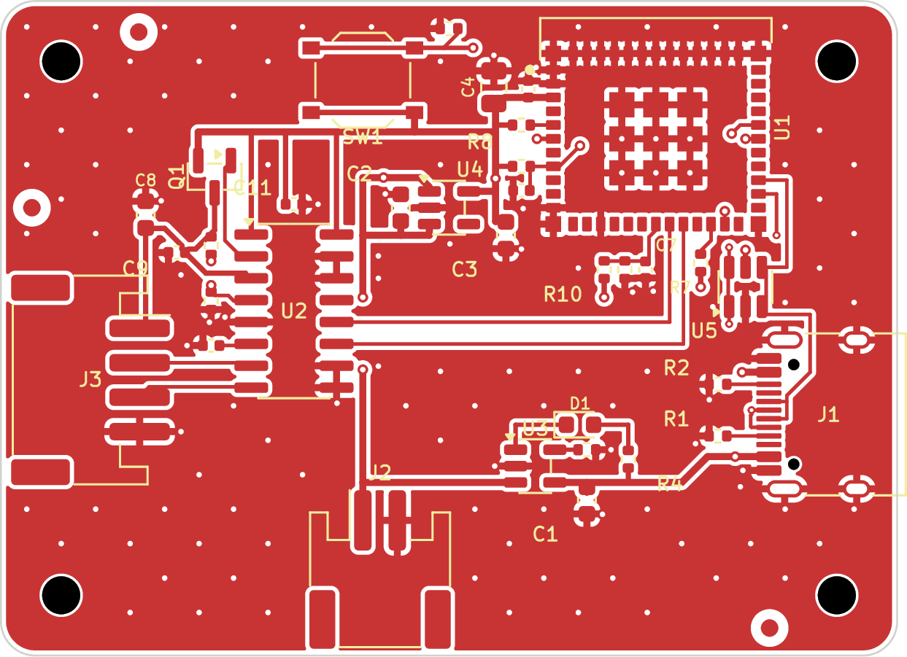
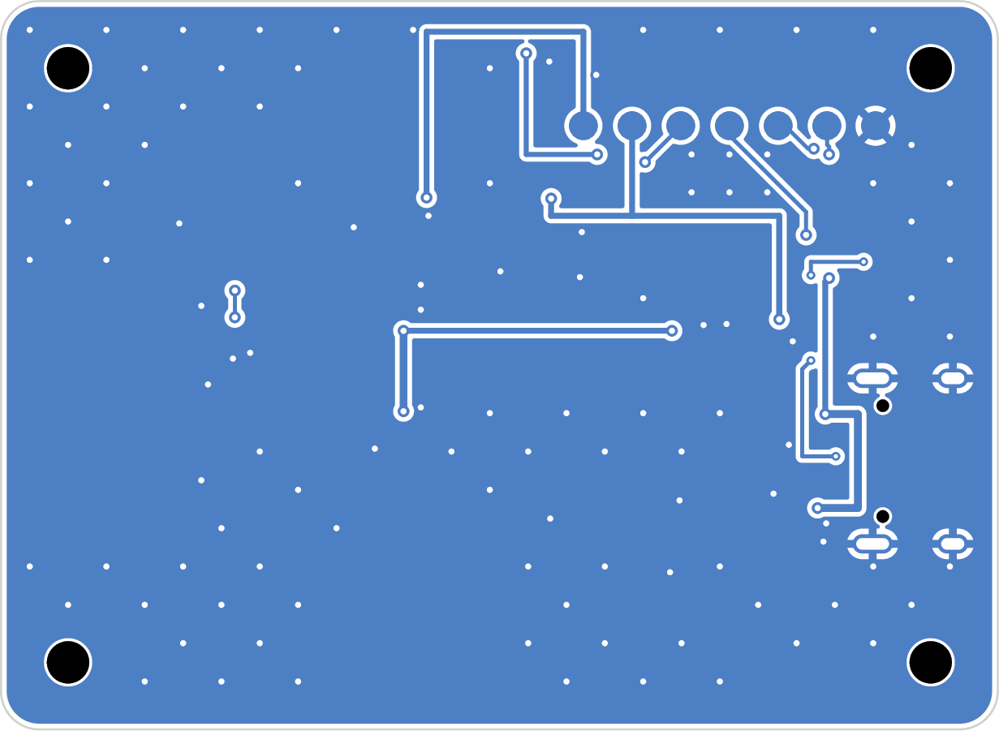

# ESP32-C3 Smart Scale

A low-power Wi-Fi/BLE smart-scale main board, designed natively in **KiCad 10**. It has a 24-bit load-cell front end, USB-C Li-ion charging, an external antenna and a ~35 µA standby budget.



| | |
|---|---|
| MCU | ESP32-C3-MINI-1U-H4 (Wi-Fi + BLE 5, U.FL external antenna, native USB) |
| Load-cell ADC | HX711, 10 SPS. Excitation is regulated by an external PNP and switched off in power-down |
| Power | USB-C → MCP73831 1S Li-ion charger (455 mA) → TLV75530 3.0 V low-Iq LDO |
| Battery gauge | 1 MΩ / 330 kΩ divider into the ESP32 ADC |
| Protection | USBLC6-2SC6 on USB D± / VBUS, 5.1 kΩ CC pull-downs |
| Programming | USB Serial/JTAG over USB-C, plus 7 underside pogo pads for a factory fixture |
| PCB | 52 × 38 mm, 2 layers, JLCPCB standard rules, 4 × M2 holes, single-sided SMT |
| Status | **Rev A, fab-ready**: ERC 0, DRC 0, schematic↔PCB parity 0, 100 % routed |

## Repository layout

```text
kicad/                       KiCad 10 project (open esp32-c3-smart-scale.kicad_pro)
  lib/smart_scale.*          project symbols, footprints, 3D models (ESP32-C3-MINI-1U, HX711, pogo pads)
fab/
  esp32-c3-smart-scale-gerbers.zip   Gerbers + Excellon drill (upload to JLCPCB)
  assembly/bom_jlcpcb.csv            BOM with LCSC part numbers
  assembly/cpl_jlcpcb.csv            pick-and-place (board origin = bottom-left)
  schematic.pdf, esp32-c3-smart-scale.step
docs/
  architecture.md            system architecture, design decisions, power budget
  design_review.md           ERC/DRC/parity + kicad-happy review results and hand calcs
  bring_up_notes.md          first-power, charging, flashing, load-cell and sleep-current procedure
  client_request.md, design_brief.html
  images/                    schematic and PCB renders
  legacy_tscircuit/          notes from the earlier tscircuit prototype
```

The original tscircuit prototype (`index.circuit.tsx`, `imports/`, `src/`, `dist/`) is kept for reference only. The KiCad project is the source of truth.

## Schematic

The schematic is a single A3 sheet, wired by signal flow: USB-C → ESD/charger → battery/LDO → MCU → load-cell ADC.



## PCB

| Top copper | Bottom copper |
|---|---|
|  |  |

The layout has three zones:

- **RF:** the module sits top-right with its U.FL at the edge.
- **Power:** USB-C, charger and battery sit bottom-right and centre.
- **Analog:** the HX711 and load-cell connector sit on the left, away from the radio.

Both layers carry solid GND pours, stitched with about 110 vias.

## Ordering (JLCPCB)

1. Upload `fab/esp32-c3-smart-scale-gerbers.zip`: 2 layers, 1.6 mm, HASL or ENIG.
2. PCBA, top side: upload `fab/assembly/bom_jlcpcb.csv` and `fab/assembly/cpl_jlcpcb.csv`. Check part rotations in JLC's preview, especially the SOT-23 parts and the USB-C.
3. Hand-fit or order the harnesses: 1S Li-ion with a JST PH 2-pin plug (pin 1 = BAT+), a 4-wire load cell on JST PH 4-pin, and a 2.4 GHz U.FL antenna.

## Toolchain

- KiCad 10.0.7: schematic capture, layout, DRC/ERC, fab outputs.
- [KiCadRoutingTools](https://github.com/drandyhaas/KiCadRoutingTools): completed the local nets after the power/USB/bus trunks were hand-placed.
- [kicad-happy](https://github.com/aklofas/kicad-happy): schematic, PCB and Gerber design-review analyzers, plus LCSC part verification.
